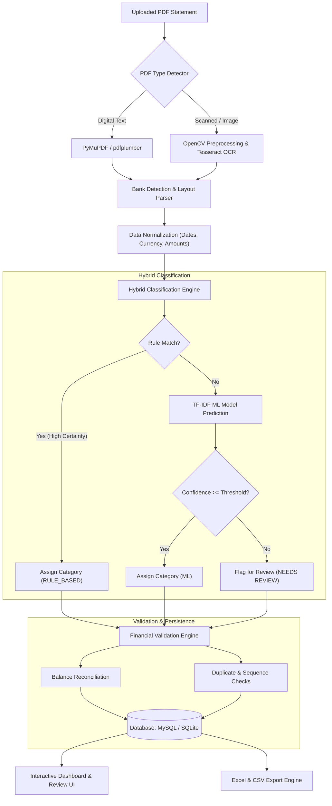
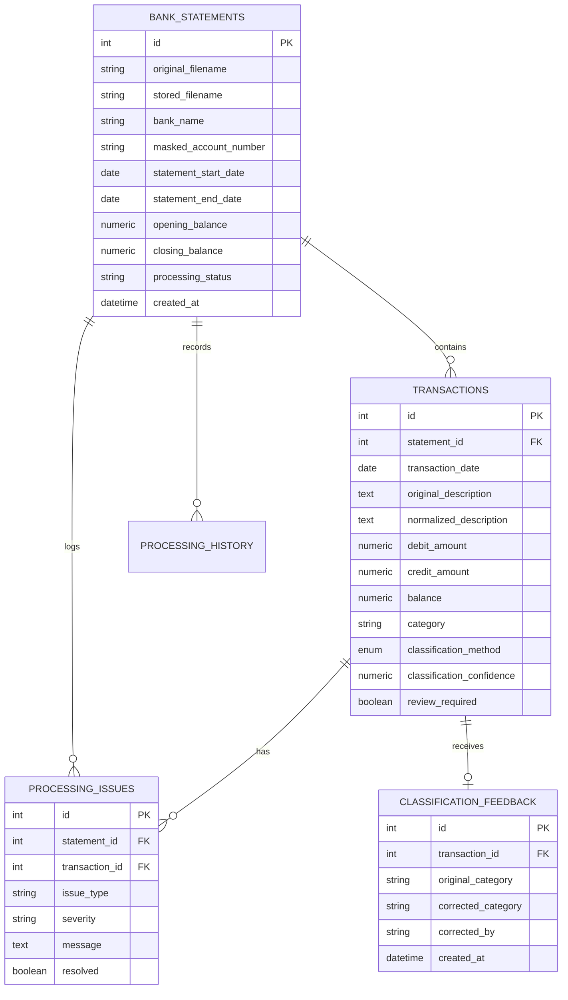

# 🏦 Bank Statement Processing & Classification System

[](https://www.python.org/)
[](https://flask.palletsprojects.com/)
[](https://www.sqlalchemy.org/)
[](https://scikit-learn.org/)
[](#-running-tests)
[](LICENSE)

An end-to-end financial document automation platform designed to ingest PDF bank statements (text-based and scanned image formats), automatically parse account details and transaction tables, categorize transactions using a **Hybrid Classification Engine** (Rule-Based + Traditional Machine Learning), validate mathematical and financial consistency, and export structured multi-sheet Excel and CSV reports.

---

## 📑 Table of Contents

- [Overview](#-overview)
- [Key Features](#-key-features)
- [System Architecture](#-system-architecture)
- [Directory Structure](#-directory-structure)
- [Database Design](#-database-design)
- [Quick Start Guide (Windows)](#-quick-start-guide-windows)
- [Detailed Installation & Setup](#-detailed-installation--setup)
- [Application Workflow](#-application-workflow)
- [Hybrid Classification Engine](#-hybrid-classification-engine)
- [Financial Validation & Reconciliation](#-financial-validation--reconciliation)
- [Export Engine (Excel & CSV)](#-export-engine-excel--csv)
- [Running Tests](#-running-tests)
- [Production Deployment](#-production-deployment)
- [Troubleshooting & FAQ](#-troubleshooting--faq)
- [License](#-license)

---

## 🎯 Overview

Financial statements distributed by banks vary drastically in layout, typography, date formats, and structure. Manual entry and reconciliation is notoriously slow and prone to errors.

This system provides:
1. **Automated Document Ingestion**: Accurately processes both digital PDF statements (via `pdfplumber` / `PyMuPDF`) and scanned camera/scanner images (via `OpenCV` and `Tesseract OCR`).
2. **Heuristic Bank Detection**: Automatically detects statement source (State Bank of India, HDFC, ICICI, etc.) based on keywords, IFSC codes, and structural anchors.
3. **Hybrid Classification**: Combines high-precision deterministic rules with a statistical machine learning fallback (TF-IDF + Linear Classifier) and an integrated manual review queue.
4. **Financial Consistency & Reconciliation**: Verifies running balances ($Opening + Credits - Debits = Closing$), identifies duplicate transactions, and detects overdraft anomalies.
5. **Multi-Sheet Reporting**: Exports structured `.xlsx` workbooks formatted according to banking audit standards alongside standardized UTF-8 CSVs.
6. **Zero-Configuration Local Development**: Built-in automatic SQLite fallback and dynamic port allocation for zero-friction local testing.

---

## 🚀 Key Features

| Capability | Description |
| :--- | :--- |
| **PDF Extraction Engine** | Dual-mode parsing utilizing PyMuPDF for fast digital extraction and OpenCV + Tesseract for OCR of scanned statements. |
| **Bank Layout Parsers** | Modular architecture supporting custom transaction table layouts, multi-line descriptions, and repeated table headers. |
| **Hybrid Categorization** | 15+ predefined financial categories with priority rule evaluation, fallback ML model, and confidence gating. |
| **Financial Validation** | Real-time balance arithmetic verification, sequence checking, and duplicate transaction flagging. |
| **Audit & Review Queue** | Interactive web interface allowing human operators to review low-confidence items and record feedback. |
| **Rich Reporting** | 5-sheet OpenPyXL export (Summary, Transactions, Category Breakdown, Validation Issues, Processing Metadata). |
| **Modern Web UI** | Clean fintech-inspired dashboard styled with CSS variables, Chart.js data visualizations, and Flask-WTF CSRF protection. |
| **Port Auto-Allocation** | Automatically checks port availability starting from `5000` to prevent port collisions on developer machines. |

---

## 🏗 System Architecture



---

## 📂 Directory Structure

```
bank_automation/
│
├── run_bank_app.bat                 # 1-Click launcher script for Windows
├── README.md                        # Master repository documentation
│
└── BankStatementSystem/             # Core application package
    ├── app.py                       # Main server entrypoint (CLI & dev server)
    ├── __init__.py                  # Application factory (create_app)
    ├── __main__.py                  # Module execution support (python -m BankStatementSystem)
    ├── config.py                    # Environment configurations (Dev, Testing, Prod)
    ├── requirements.txt             # Locked Python dependencies
    ├── .env.example                 # Environment variables template
    │
    ├── app/                         # Flask application sub-package
    │   ├── extensions.py            # SQLAlchemy, Migrate, and CSRF singletons
    │   ├── models/                  # Database models
    │   │   ├── bank_statement.py    # Statement metadata entity
    │   │   ├── transaction.py       # Financial transaction entity
    │   │   ├── processing_issue.py  # Validation error/warning entity
    │   │   ├── processing_history.py# Audit trail entity
    │   │   └── classification_feedback.py # User review feedback entity
    │   │
    │   ├── routes/                  # View controllers & blueprints
    │   │   ├── main.py              # Dashboard, upload, statement view, exports
    │   │   ├── dashboard.py         # Summary analytics routes
    │   │   └── health.py            # Health check endpoint (/health)
    │   │
    │   ├── services/                # Business logic services
    │   │   ├── bank_detection/      # Bank heuristics & detector
    │   │   ├── classification/      # Rule engine, ML pipeline, hybrid classifier
    │   │   ├── export/              # OpenPyXL and CSV generation service
    │   │   ├── parsing/             # Bank layout table parsers
    │   │   ├── pdf_processing/      # PDF text extractor & OCR pipeline
    │   │   └── validation/          # Mathematical reconciliation engine
    │   │
    │   ├── static/                  # Stylesheets, JavaScript, and branding
    │   └── templates/               # Jinja2 HTML templates
    │
    ├── instance/                    # Local runtime storage (ignored in VCS)
    │   ├── uploads/                 # Stored PDF statements
    │   ├── exports/                 # Temporary generated exports
    │   └── bank_statement.db        # SQLite database (when MySQL is offline)
    │
    ├── ml/                          # Machine Learning artifacts
    │   ├── datasets/                # Labeled transaction datasets
    │   └── models/                  # Saved joblib classifiers
    │
    ├── migrations/                  # Alembic database migration scripts
    └── tests/                       # Automated test suite
        ├── conftest.py              # Pytest environment fixtures & path setup
        └── unit/                    # Unit tests (Hybrid classifier, parsing, etc.)
```

---

## 🗄 Database Design

The database schema manages the entire lifecycle from raw file upload to audited transaction rows.



> [!NOTE]
> **Zero-Configuration Fallback**: If MySQL is not running locally on port `3306`, the application automatically falls back to an embedded SQLite database at `instance/bank_statement.db`. When you are ready for production, simply point `DB_HOST` in `.env` to your MySQL instance.

---

## ⚡ Quick Start Guide (Windows)

### The 1-Click Method
Simply double-click the included batch script from the project folder:
```
C:\Users\ADMIN\Desktop\bank_automation\run_bank_app.bat
```
This script will:
1. Automatically activate the virtual environment (`.venv`).
2. Verify all requirements.
3. Search for the first open port starting at `5000` (e.g., `5000`, `5001`).
4. Bind to the local loopback address (`http://127.0.0.1:<PORT>`) and launch the web server.

### The PowerShell Method
```powershell
# 1. Navigate to the project directory
cd C:\Users\ADMIN\Desktop\bank_automation\BankStatementSystem

# 2. Activate the virtual environment
.\.venv\Scripts\Activate.ps1

# 3. Launch the server
python app.py
```

Once running, open your browser and navigate to:
```
http://127.0.0.1:5000
```
*(If port 5000 was in use by another tool, the console will print the exact active URL, e.g. `http://127.0.0.1:5001`).*

---

## 🛠 Detailed Installation & Setup

### 1. Prerequisites
- **Python 3.12+** installed and added to your system `PATH`.
- **Git** (optional, for version control).
- **Tesseract OCR** (optional, only required if processing scanned/image PDFs):
  - Download from: [UB-Mannheim Tesseract Releases](https://github.com/UB-Mannheim/tesseract/wiki)
  - Install to `C:\Program Files\Tesseract-OCR\tesseract.exe`.
- **MySQL 8.0+** (optional, for production deployments).

### 2. Environment Setup
```powershell
cd C:\Users\ADMIN\Desktop\bank_automation\BankStatementSystem

# Create virtual environment
python -m venv .venv

# Activate virtual environment
.\.venv\Scripts\Activate.ps1

# Upgrade package manager & install dependencies
python -m pip install --upgrade pip
pip install -r requirements.txt
```

### 3. Environment Variables (.env)
Copy `.env.example` to create your active `.env`:
```powershell
copy .env.example .env
```
Default configuration values:
```ini
FLASK_APP=BankStatementSystem.app
FLASK_ENV=development
SECRET_KEY=dev-secret-key-change-in-production
PORT=5000

# Database Configuration (MySQL)
# Leave as-is for SQLite automatic fallback
DB_HOST=localhost
DB_PORT=3306
DB_NAME=bank_stmt_db
DB_USER=root
DB_PASSWORD=

# ML & OCR settings
ML_CONFIDENCE_THRESHOLD=0.60
OCR_TESSERACT_PATH=C:\Program Files\Tesseract-OCR\tesseract.exe
```

---

## 🖥 Application Workflow

```
[Upload Statement]  ──>  [Validation & OCR]  ──>  [Parser Extraction]
                                                          │
[Excel / CSV Export] <── [Financial Check] <── [Hybrid Classifier]
```

1. **Upload (`/upload`)**: Select any PDF bank statement. The system validates the header, page count, and checks for password locks.
2. **Detection & Extraction**: PyMuPDF analyzes text density. Scanned pages are routed to OpenCV for grayscale conversion, Gaussian blur, and Tesseract OCR.
3. **Classification**:
   - Matches against word-boundary keywords (e.g., `SWIGGY` $\to$ **Food & Dining**, `NEFT` $\to$ **Transfers**).
   - If unmatched, invokes the TF-IDF Scikit-Learn pipeline.
   - Predictions below `ML_CONFIDENCE_THRESHOLD` (0.60) are routed to the **Review Queue**.
4. **Dashboard (`/`)**: Displays statement summary statistics, total debits, total credits, net balance, and flags needing manual attention.
5. **Review Queue (`/review`)**: Allows operators to manually categorize flagged transactions. Corrections are saved to `classification_feedback` for future model retraining.
6. **Export**: One-click download of standardized CSVs and multi-sheet Excel workbooks.

---

## 🧠 Hybrid Classification Engine

The system uses a sequential priority hierarchy to maximize classification accuracy:

```
Transaction Description
         │
         ▼
[Step 1: Text Normalization]
  • Convert to uppercase
  • Collapse excess whitespace
  • Strip invalid control characters
         │
         ▼
[Step 2: Rule-Based Evaluation]
  • Test priority keywords with regex word-boundaries (\bKEYWORD\b)
  • Reliable match found? ──> YES ──> Assign Category [RULE_BASED]
         │ (NO)
         ▼
[Step 3: Machine Learning Model]
  • Run TF-IDF Vectorizer + Scikit-Learn Classifier
  • Evaluate confidence score:
    - Confidence >= 0.60 ──> Assign Category [ML]
    - Confidence < 0.60  ──> Mark as 'Others / Needs Review' [REVIEW]
```

### Supported Financial Categories
- `Food & Dining`
- `Shopping`
- `Transportation`
- `Entertainment`
- `Healthcare`
- `Utilities`
- `Education`
- `Income`
- `Transfers`
- `Cash Withdrawal`
- `Bank Charges`
- `Refunds`
- `Loan Payments`
- `Investment`
- `Others / Needs Review`

---

## ⚖ Financial Validation & Reconciliation

The engine performs mathematical audit checks on all parsed transactions:

1. **Balance Reconciliation**:
   $$\text{Expected Balance}_i = \text{Balance}_{i-1} + \text{Credit}_i - \text{Debit}_i$$
   Any difference exceeding a tolerance threshold flags a `ProcessingIssue` of severity `ERROR`.
2. **Duplicate Detection**:
   Identifies identical amounts, dates, and normalized descriptions appearing within close sequence.
3. **Date Consistency**:
   Validates that all transaction dates fall within the statement's stated start and end periods.
4. **Outlier & Overdraft Alerts**:
   Identifies negative balances or sudden atypical value spikes.

---

## 📊 Export Engine (Excel & CSV)

### 1. Multi-Sheet Excel Workbook (`.xlsx`)
Built using `OpenPyXL` with frozen header rows, styled headers, autofilters, and column auto-sizing:

- **Sheet 1: Account Summary** — Bank name, masked account number, holder name, statement period, starting & closing balance, total transactions.
- **Sheet 2: Transactions** — Complete table of standardized and classified transactions with audit flags.
- **Sheet 3: Category Summary** — Aggregated transaction counts, total debits, and total credits per category.
- **Sheet 4: Validation Report** — Log of balance mismatches, duplicate warnings, and parser anomalies.
- **Sheet 5: Processing Report** — PDF type, extraction method, ML models used, page count, and system timestamps.

### 2. Standardized CSV Export
- Clean CSV formatted in **UTF-8 with BOM** (`utf-8-sig`) for native compatibility with Microsoft Excel without character corruption.
- Includes formula-injection sanitization (prepends single-quotes to cells starting with `=`, `+`, `-`, or `@`).

---

## 🧪 Running Tests

The test suite validates the hybrid classifier, edge-case fallbacks, and parsing engines.

To run the automated tests:
```powershell
# From the project root
cd C:\Users\ADMIN\Desktop\bank_automation\BankStatementSystem
.\.venv\Scripts\Activate.ps1
pytest -v
```

Expected output:
```
tests/unit/test_hybrid_classifier.py::test_rule_based_match PASSED        [ 33%]
tests/unit/test_hybrid_classifier.py::test_ml_fallback_low_confidence PASSED [ 66%]
tests/unit/test_hybrid_classifier.py::test_ml_fallback_high_confidence PASSED [100%]

============================== 3 passed in 0.86s ==============================
```

---

## 🚢 Production Deployment

### Option 1: Running with Waitress (Production WSGI on Windows)
```powershell
pip install waitress
waitress-serve --listen=127.0.0.1:8000 BankStatementSystem:create_app
```

### Option 2: Running with Gunicorn (Linux / Container)
```bash
pip install gunicorn
gunicorn -w 4 -b 0.0.0.0:8000 "BankStatementSystem:create_app()"
```

### Option 3: Docker & Docker Compose
Create your container using the provided stack:
```bash
docker compose up --build -d
```
The application will launch with a MySQL 8.0 database container and Gunicorn application server on port `8000`.

---

## ❓ Troubleshooting & FAQ

### Q1: Browser says `ERR_ADDRESS_INVALID` when opening `http://0.0.0.0:5000/`
> **Solution**: `0.0.0.0` is a listen address for all interfaces; web browsers cannot route to it directly. Always open **`http://127.0.0.1:5000`** or **`http://localhost:5000`**.

### Q2: What if port 5000 is occupied by another service?
> **Solution**: You don't need to change anything. The application automatically detects if port `5000` is busy and binds to the next free port (`5001`, `5002`, etc.), displaying the exact URL in the console.

### Q3: `MySQL server on 'localhost' refused connection`
> **Solution**: The application automatically falls back to an embedded SQLite database (`instance/bank_statement.db`). You do not need to install or run MySQL for local development.

### Q4: Scanned PDFs fail with `TesseractNotFoundError`
> **Solution**: Install Tesseract OCR from [UB-Mannheim](https://github.com/UB-Mannheim/tesseract/wiki) and ensure the executable path in `.env` is set to `OCR_TESSERACT_PATH=C:\Program Files\Tesseract-OCR\tesseract.exe`. Digital/text-based PDFs work out-of-the-box without Tesseract.

---

## 📄 License

This project is licensed under the MIT License. See the [LICENSE](LICENSE) file for details.
